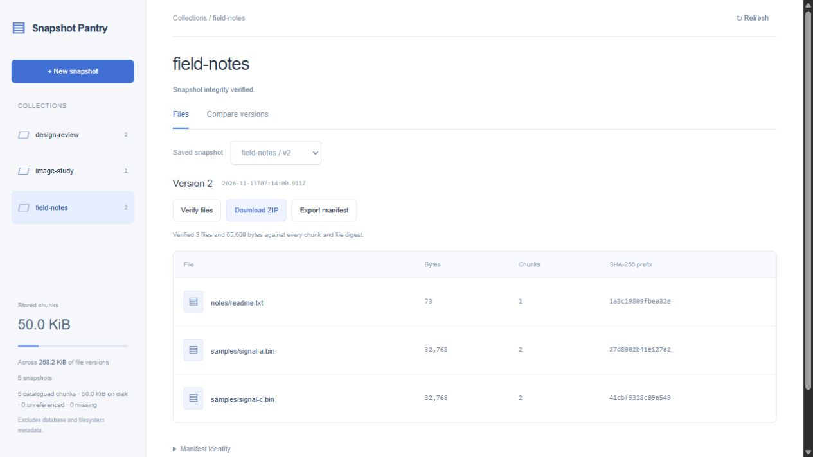

# Snapshot Pantry

A local file-snapshot store with content-addressed deduplication, immutable version manifests, integrity verification, snapshot comparison, and verified ZIP restoration.



## Interface

The file-browser layout groups saved collections in the left navigation and keeps storage usage visible while scrolling. The main file table opens a selected snapshot; **Compare versions** switches to the manifest comparison. **New snapshot** opens a centered staging dialog, with local file selection, relative paths, and sample bundles. Saving closes the dialog and selects the new version. Narrow screens use a horizontally scrollable collection list and file table.

## Run

Requires Python 3.10+. No runtime dependencies or API keys.

```sh
python run.py --port 8000
```

Open http://127.0.0.1:8000/. The ignored `data/` directory holds SQLite metadata and chunk files. Use `--data path/to/pantry` for another store. Fresh stores are empty; sample buttons stage fictional files without saving them automatically.

## Workflows

- Choose files, edit their logical relative paths, and save a snapshot into a named collection.
- Stage the baseline/revised studies to explore deduplication and change classification.
- Open any saved snapshot and inspect file sizes, chunk counts, and hashes.
- Verify manifest, chunk, and reconstructed-file integrity.
- Restore a ZIP only after every content check succeeds.
- Compare any two snapshot manifests and export their added/removed/modified/unchanged paths.
- Export a manifest with full file/chunk digests for inspection.

Adding a file at the same staged path replaces that draft entry. Saving does not clear staging, so subsequent changes can become the next collection version. Browser refresh discards the draft; saved snapshots remain. Refresh ledger preserves staged files while updating the expected version. A concurrent stale save receives 409 instead of silently advancing from an outdated base.

## Reproduce the study

1. Keep collection `field-notes`, stage the baseline study, and save version 1.
2. Stage the revised study and save version 2.
3. Compare versions 1 and 2, verify version 2, and restore its ZIP.

Each snapshot contains 65,609 logical bytes. Together they reference 131,218 bytes while using four catalogued chunks totaling 49,225 bytes. One file is added, one removed, one modified, and one unchanged. The rename-like change is intentionally reported as remove/add rather than inferred as a rename.

The [example manifest](docs/example-manifest.json) and [comparison](docs/example-comparison.json) show these outputs. A manifest contains metadata and hashes, not content; it is insufficient for restoration without the chunk store.

## Storage design

Files are divided into fixed 16 KiB chunks. A blob is addressed by SHA-256 under `blobs/<first-two-hex>/<full-hash>`. Identical chunks share a file across paths, snapshots, and collections. Empty files have no chunks and retain the SHA-256 of empty content.

Uploads are validated completely before writes. Publication takes a SQLite `BEGIN IMMEDIATE` transaction, checks the collection's expected version, writes missing chunks through flushed/fsynced temporary files and atomic replacement, inserts chunk catalog entries, and commits a complete immutable snapshot manifest. Existing chunks are verified before reuse. Concurrent writers to the same expected version have exactly one winner.

The filesystem and SQLite are not one atomic transaction. If publication fails after writing chunks, the database rolls back and no incomplete snapshot is published, but unreferenced blobs can remain. The storage view reports these separately; a later successful upload can reuse them. There is no deletion or garbage collection. Filesystem directory durability is platform-dependent; the app does not claim power-loss-proof storage. Back up the entire data directory while the service is stopped.

Each canonical JSON manifest has a digest and validated schema. Verification reads every referenced chunk, checks its size/hash, reconstructs each file, and checks the file size/hash. Restore completes the same checks before returning a ZIP. A failure returns an error rather than a partial archive. ZIPs preserve bytes and logical paths, not original timestamps, permissions, symlinks, or directory metadata; entries use a fixed timestamp and regular-file mode.

Hashes detect accidental corruption, not an attacker able to rewrite both metadata and content. This is an unencrypted, unauthenticated loopback laboratory, not a replicated backup service or an independent backup of its own data.

## Accounting

Logical bytes sum file sizes across every snapshot, including repeated references. Catalogued chunk bytes count distinct committed chunks once. Physical chunk bytes sum hash-named files on disk, including unreferenced chunks. Database/filesystem metadata, temporary files, and generated ZIP compression are excluded. Storage accounting is an observation, not a content-integrity scan; concurrent writes can briefly appear as unreferenced files. Use Verify for content checks. Snapshot comparison reads validated manifests and does not reread chunks.

## API

| Endpoint | Purpose |
| --- | --- |
| `GET /api/state` | Snapshot shelf and storage accounting |
| `GET /api/snapshots/{id}` | Manifest and snapshot identity |
| `GET /api/snapshots/{id}/zip` | Verified ZIP restoration |
| `POST /api/snapshots` | `{collection, expected, files: [{path, base64}]}` |
| `POST /api/verify` | `{id}`; verify every referenced file |
| `POST /api/compare` | `{before, after}`; manifest comparison |

Errors use JSON `{error}`: 400 validation, 403 origin, 404 missing, 409 stale version, 413 body limit, 415 content type, 422 integrity failure, or 503 unavailable local storage. The server binds to 127.0.0.1, validates Host/Origin, rejects duplicate JSON fields/nonfinite constants, and serves only explicit static assets. Data directories are not exposed as static files.

## Limits

At most 200 snapshots per store, 32 files per snapshot, 2 MiB per file, and 4 MiB total file data per snapshot. POST bodies are capped at 6 MB to accommodate base64. The browser checks aggregate sizes before reading selected files into memory.

Collections use 1–48 lowercase letters/digits/hyphens, starting with a letter. Logical paths use at most four components and 180 total characters, with simple ASCII names. Traversal, absolute paths, backslashes, hidden names, Windows device names, trailing dots/spaces, case-insensitive duplicates, and file/directory prefix conflicts are rejected. No filesystem extraction occurs on the server.

## Validation

Node.js 22+ is needed only for frontend syntax checking.

```sh
python -m unittest discover -s tests -v
npm run check
```

Twelve tests cover binary/empty/nested-file restoration, deduplication across files/versions/collections, eight competing writers, injected transaction rollback and orphan reuse, corrupted/missing chunks, manifest/file hashes, all comparison categories, portable-path collisions and prefix conflicts, bounds, HTTP behavior, and prevention of corrupt ZIP downloads. CI runs Python 3.11/3.13 on Ubuntu and Windows.

Browser checks covered baseline/revised snapshot creation, verification, comparison, manifest/ZIP downloads, unsafe-path rejection without a new version, real PNG upload/restoration, and persistence after refresh. Independent Python checks verified all sample ZIP bytes, every chunk/file hash, canonical manifest digest, comparison categories, and exact uploaded-PNG restoration.

The file-browser redesign was checked in the browser at desktop and 390-pixel widths. Checks covered collection navigation, verifying stored files, dialog dismissal, staging and saving two fictional design-review versions, and a comparison with one added, removed, modified, and unchanged file.
